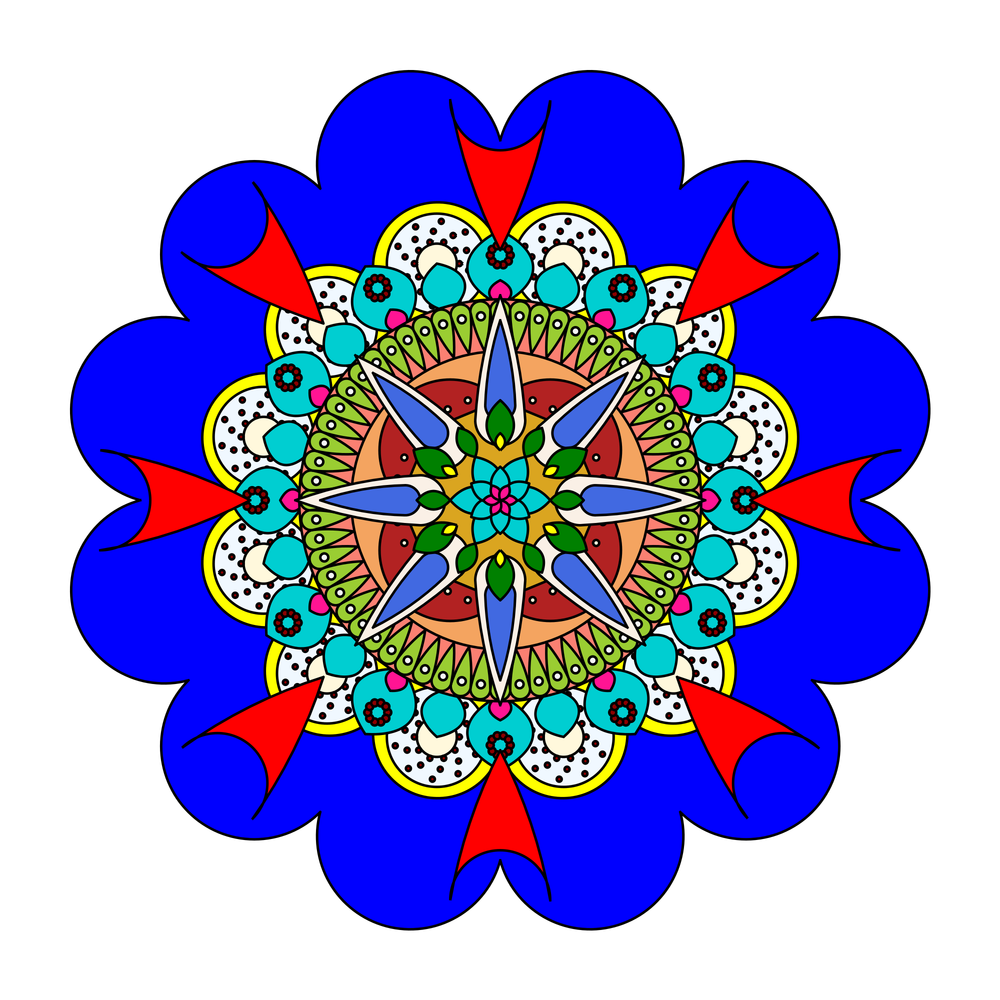

# Documentation of the task "04-Mandala"

## Author

Jakub Rollo

## Command line arguments

`--output`: Output filename for the generated mandala image.

`--width`: Width of the image in pixels. Default value: 2048.

`--height`: Height of the image in pixels. Default value: 2048.

## Algorithm

The implemented algorithm utilizes the ImageSharp library for drawing mandala pattern. The algorithm involves defining a static mandala pattern and allowing the width and height parameters to change the cut of this static mandala. The mandala is drawn using paths, segments, a lot of arcLineSegments, circles etc.

## Use of AI

I tried to use ChatGPT to help me with the ImageSharp library to learn how to work with paths and curves. Unfortunately it did not help me this way at all because it showed outdated methods which didn't work (as it turned out ImageSharp.Drawing had a lot of updates in the last year or two). So I had to learn everything from the documentation. It did help me with some math to make the calculations in my code work as I wanted it (move point in a given rotation and distance etc.).

## Bonuses

My code is able to handle rectangular (Width != Height) image aspect ratios
I also hope it has a bit of a visual appeal.

## The mandala image in its glory
